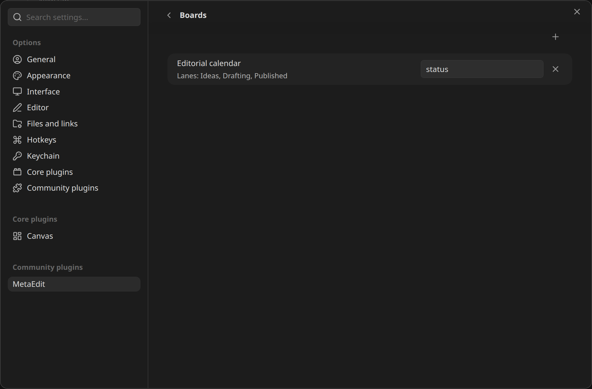

Move a card between lanes on a Kanban board and the linked note's property updates to match. Drag `[[Dune review]]` from "Drafting" to "Published", and about 5 seconds later the note's `status` property reads `Published` - no manual editing.

For a full worked setup, see the [Kanban status sync recipe](/cookbook/kanban-status-sync/).

:::caution[Requirements]
- **The community Kanban plugin.** MetaEdit discovers boards by looking for the `kanban-plugin` frontmatter key that plugin writes, so the settings picker only offers its boards.
- **The property must already exist in each linked note.** Like [Progress Properties](/guides/progress-properties/), the helper only updates existing properties - it never creates them. Add `status` (or whatever key you sync) to every card's note first; see [create properties](/guides/create-properties/).
:::

## Set it up

1. Open Settings and go to the MetaEdit tab.
2. Turn on the "Kanban board helper" toggle. It takes effect immediately.
3. Click the "Boards" row to open its page.
4. Click the "+" button ("Add board") and pick a board. The picker lists every note with a `kanban-plugin` frontmatter key that you have not added yet.
5. In the board's row, type the property key to sync into the "Property in linked notes" field (for example `status`). The "Lanes:" line under the board name previews the board's current lane headings.



If every board is already added, or the vault has none, a notice reads "MetaEdit found no other Kanban boards in this vault."

Changes save immediately. From now on, moving a card writes the new lane's heading text into the configured property of the note the card links to.

## How it decides what to write

A Kanban card is a top-level task line whose content starts with a link:

```md
---
kanban-plugin: board
---

## Ideas

- [ ] [[Post about tags]]

## Drafting

- [ ] [[Dune review]] @[[2026-07-15]]

## Published
```

The helper follows these rules:

- **Only the leading link counts.** In `- [ ] [[Dune review]] @[[2026-07-15]]`, only `[[Dune review]]` identifies the card's note. Trailing links on the same line (Kanban date links, `see [[ref]]` references) and indented sub-checklist items are ignored.
- **The lane is the nearest heading above the card.** Moving the card under "## Published" writes `Published`.
- **Cards above the first heading are skipped.** They have no lane to write.
- **Ambiguous links are skipped, not guessed.** If a bare link like `[[Dune review]]` could refer to several notes with the same basename and Obsidian's link resolution cannot settle it, the helper bails for that card rather than write to the wrong note.
- **Writes only happen when the value actually differs.** Re-saving a board without moving cards is a no-op.

The write itself uses MetaEdit's normal property update, so it works whether the note stores the property in YAML frontmatter or as an inline Dataview field - see [write safety](/concepts/write-safety/).

## When it runs

The helper shares its trigger pipeline with Progress Properties: modify event only, markdown files with YAML frontmatter, Excalidraw skipped, unchanged content skipped, and a 5-second debounce that resets while you keep editing. The full list is in [how and when updates run](/guides/progress-properties/#how-and-when-updates-run).

## If the property is missing

When a card's note lacks the configured property, MetaEdit shows a notice for that card:

```text
MetaEdit: (WARNING) 'status' not found in "Dune review" (Kanban board 'Editorial calendar').
```

This is a warning - nothing is broken. Fix it by adding the property to the note. See the [notices reference](/reference/notices/) for every message MetaEdit can show.

## Caveats

- **Renaming a board file breaks its row.** Boards are matched by file basename, and the stored name is not updated on rename. Remove the stale row and re-add the board under its new name. A row whose board file no longer exists shows "Board not found." under its name.
- **Per-card failures never abort the board.** One unresolvable link or a linked note with malformed YAML is logged to the developer console, and the rest of the cards still sync.
- **Property names match exactly and case-sensitively**, like everywhere else in MetaEdit.

For the full settings tour, see the [settings reference](/reference/settings/).
