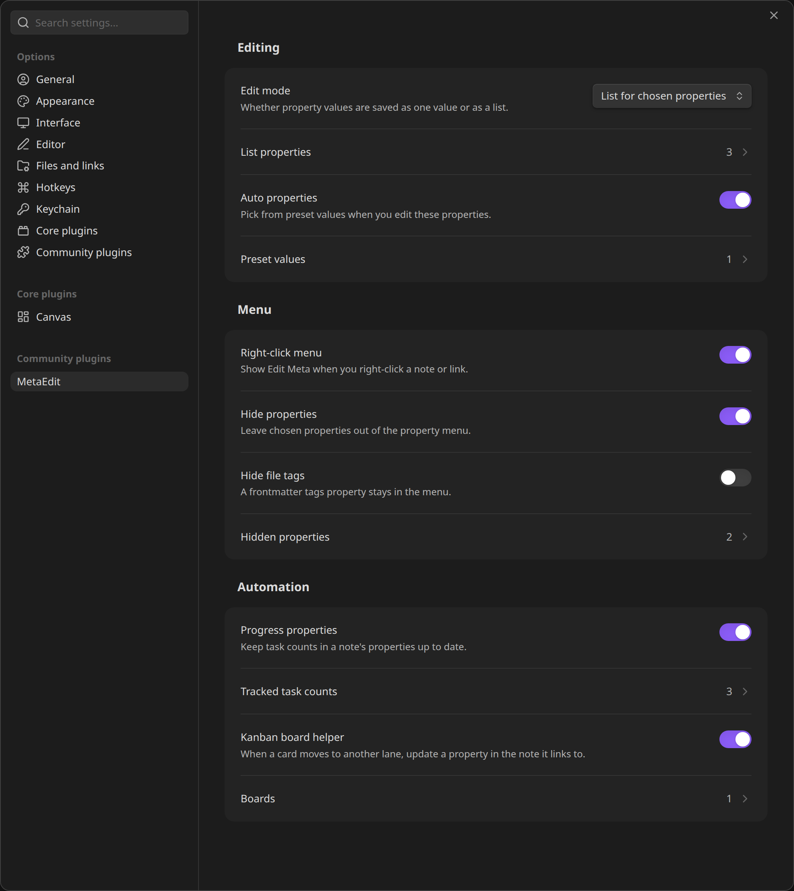
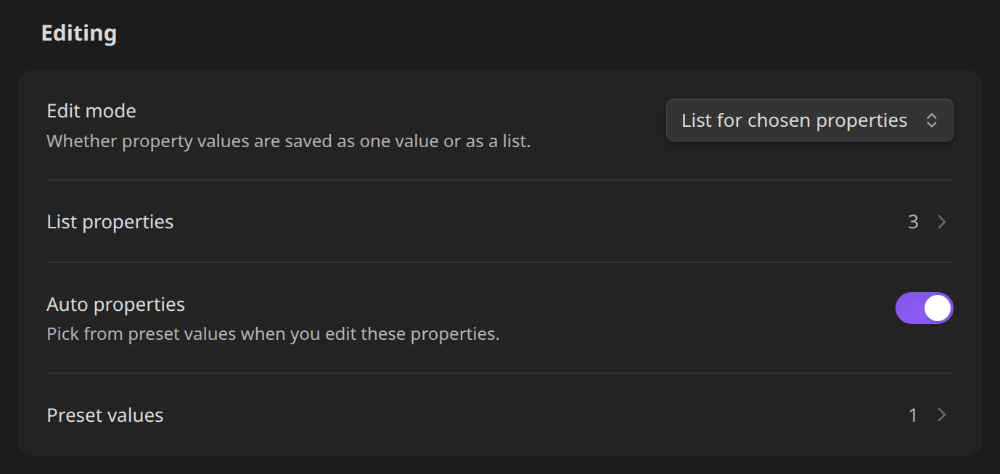
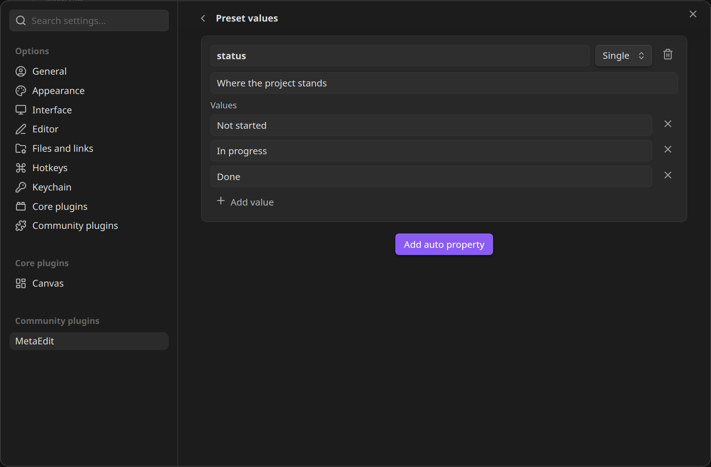
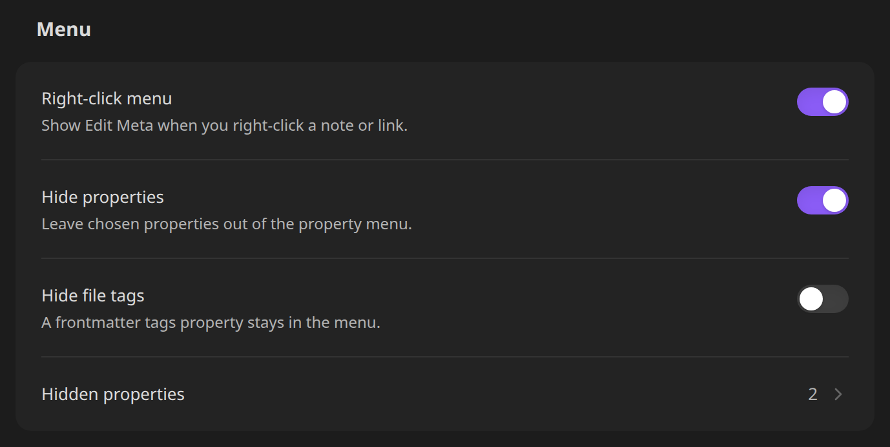

This page documents every MetaEdit setting in the order the tab shows them, with each setting's exact name, description, default, and what its sub-page contains. Open them under Settings, in the "MetaEdit" tab. The tab has three groups: "Editing", "Menu", and "Automation".

Three things apply everywhere:

- **Changes save immediately.** There is no Save button anywhere in the tab, and writes are serialized. If a save fails, a notice appears: "MetaEdit could not save the setting: {reason}". Edits on the "Preset values" page also roll back when their save fails.
- **Sub-pages open in place.** A row with a count on the right is a sub-page. Click it to open its settings page, and use the back arrow to return. A feature's sub-page row shows only while that feature is on.
- **Settings search finds every MetaEdit setting.**

## Defaults at a glance

| Setting | Default | Takes effect |
| --- | --- | --- |
| "Edit mode" | "One value" | Immediately |
| "Auto properties" | Off | Immediately |
| "Right-click menu" | On | Immediately (registers or unregisters the menus live) |
| "Hide properties" | Off | Next time the picker opens |
| "Hide file tags" | Off | Next time the picker opens |
| "Progress properties" | Off | Immediately (attaches the automator live) |
| "Kanban board helper" | Off | Immediately (attaches the automator live) |

"Right-click menu" is the only setting that defaults to on.

## Editing

### Edit mode

- **Description:** "Whether property values are saved as one value or as a list."
- **Dropdown values:** "One value" (default), "List", "List for chosen properties".

Controls whether property values are edited (and created, on the legacy paths) as single values or as lists. See [lists and multi-values](/guides/lists-and-multi-values/) for the full routing rules.

:::note[Where Edit mode applies]
Edit mode does not apply to YAML properties edited or created with Obsidian's native widgets - it governs inline Dataview fields, non-native YAML scalars, and the legacy add paths (transform to YAML, the API's `createYamlProperty`, and [bulk edit](/guides/bulk-edit/)). YAML lists are inherently multi-value whatever the mode says: a real top-level frontmatter list opens Obsidian's native list widget, and a non-native YAML list (for example a nested array) always uses the legacy list editor - see [work with lists and multi-value properties](/guides/lists-and-multi-values/). An [Auto Property](/guides/auto-properties/) with an explicit "Single" or "Multi" type also overrides Edit mode for its key.
:::

### List properties

A sub-page row, shown only while "Edit mode" is "List for chosen properties". It lists the properties treated as lists. Everything else is one value.

- The "+" button ("Add property") asks for a property name. Blank names and names already in the list are ignored.
- The "x" on a row deletes it.

Name matching is exact and case-sensitive. Choosing "One value" or "List" hides the row, but the stored list persists across mode switches - it comes back when you return to "List for chosen properties".

### Auto properties

- **Description:** "Pick from preset values when you edit these properties."
- **Default:** off.

Enables [Auto Properties](/guides/auto-properties/): predefined value sets that replace free-text prompts when you edit or create a matching property. While the toggle is off, no Auto Property activates anywhere, including the `autoprop()` [API call](/api/auto-properties/).

### Preset values

A sub-page row, shown only while "Auto properties" is on. Its count is the number of auto properties defined.

With no properties defined, the page shows: "No auto properties yet. Add one to define a reusable set of values for a property." Each auto property renders as a card containing:

| Control | Details |
| --- | --- |
| Name input | Placeholder "Property name". Matched exactly and case-sensitively against property keys |
| Type dropdown | "Single" or "Multi" (new properties start as "Single") |
| Remove button | Trash icon, "Remove this auto property" |
| Description input | Placeholder "Description (shown when you pick a value) - optional" |
| "Values" list | One text input per choice, placeholder "Value (or paste a list)", each with an x "Remove value" button |
| "Add value" | Appends an empty value box |

At the bottom of the page, "Add auto property" appends a new card. There is no reorder control; new items always append at the end.

**Paste a whole list:** pasting into a value box splits the text into individual choices - on lines when the text contains any line break, otherwise on commas. Tokens are trimmed, blanks dropped, and duplicates skipped. A paste that yields fewer than two tokens behaves like a normal paste.

If a save fails, the change is rolled back and a notice appears: "MetaEdit could not save the Auto Properties setting: {reason}".

## Menu

### Right-click menu

- **Description:** "Show Edit Meta when you right-click a note or link."
- **Default:** on.

Gates all three context-menu items - "Edit Meta" plus both bulk edit items - even though the description mentions only "Edit Meta". Turning it off unregisters the menu handlers immediately; turning it on brings them back, no restart needed. See [commands and menus](/reference/commands-and-menus/#context-menu-items).

### Hide properties

- **Description:** "Leave chosen properties out of the property menu."
- **Default:** off.

Filters which rows the [property picker](/reference/commands-and-menus/#the-property-picker) lists. While the toggle is off, nothing is filtered, and the "Hide file tags" and "Hidden properties" rows are hidden.

Filtering only hides picker rows - it never deletes anything from your notes. Hidden-but-present keys are also excluded from the "New YAML property" and "New Dataview field" name suggestions, so you cannot accidentally re-create a key the note already has.

:::note[Upgrading from an older MetaEdit]
This feature was previously named "Ignored Properties", and its storage key in `data.json` is still `IgnoredProperties`. Old versions applied the ignore list even while the feature toggle was off, so on first load after upgrading, a vault with the feature disabled but a non-empty ignore list gets the toggle switched on once, automatically. That preserves your previous filtering; turn it off afterwards if you no longer want it, and it will stay off.
:::

### Hide file tags

- **Description:** "A frontmatter tags property stays in the menu."
- **Default:** off. Shown only while "Hide properties" is on.

Removes the note's body `#tag` rows from the picker, leaving only frontmatter and inline fields. A frontmatter `tags` property stays editable.

### Hidden properties

A sub-page row, shown only while "Hide properties" is on. It lists the property names to hide from the picker.

- The "+" button ("Add property") asks for a property name. Blank names and names already in the list are ignored.
- The "x" on a row deletes it.

A property is hidden when its key exactly matches a listed name. Matching is case-sensitive, with no wildcards.

## Automation

### Progress properties

- **Description:** "Keep task counts in a note's properties up to date."
- **Default:** off.

Enables the [Progress Properties](/guides/progress-properties/) automator, which keeps task-count properties in your notes up to date. Toggling attaches or detaches the automator immediately - no reload needed.

### Tracked task counts

A sub-page row, shown only while "Progress properties" is on. Each entry pairs a property name with the count it holds.

- The "+" button ("Add property") asks for the property name. Blank names and names already in the list are ignored. New entries default to "Total tasks".
- Each row has a dropdown with exactly three counts: "Total tasks", "Completed tasks", "Incomplete tasks".
- The "x" on a row deletes it.

Property names match exactly and case-sensitively, and the automator only updates properties that already exist in a note - it never creates them. In `data.json` the counts are stored as `Total Tasks`, `Completed Tasks`, and `Incomplete Tasks`.

### Kanban board helper

- **Description:** "When a card moves to another lane, update a property in the note it links to."
- **Default:** off.

Enables the [Kanban Board Helper](/guides/kanban-helper/) automator. Toggling attaches or detaches it immediately.

### Boards

A sub-page row, shown only while "Kanban board helper" is on. Each entry is one board.

- The "+" button ("Add board") opens a picker of Kanban boards that are not added yet: markdown files whose frontmatter contains a `kanban-plugin` key, in practice boards created by the community Kanban plugin. The picker reads your vault when you click, so it includes boards created while the tab is open. If there are none, a notice appears: "MetaEdit found no other Kanban boards in this vault."
- Each row shows the board file's basename, with "Lanes: {headings}" under it listing the board's lane headings. A board without headings shows "No lanes yet.", and a board file that no longer exists shows "Board not found."
- Each row has a text field (placeholder "Property in linked notes") for the property to update in the notes the board's cards link to.
- The "x" on a row deletes it.

## Related pages

- [Commands and menus](/reference/commands-and-menus/) - the entry points these settings shape
- [Notices and error messages](/reference/notices/) - settings-related notices
- [Troubleshooting](/help/troubleshooting/) - when a setting does not seem to take effect
